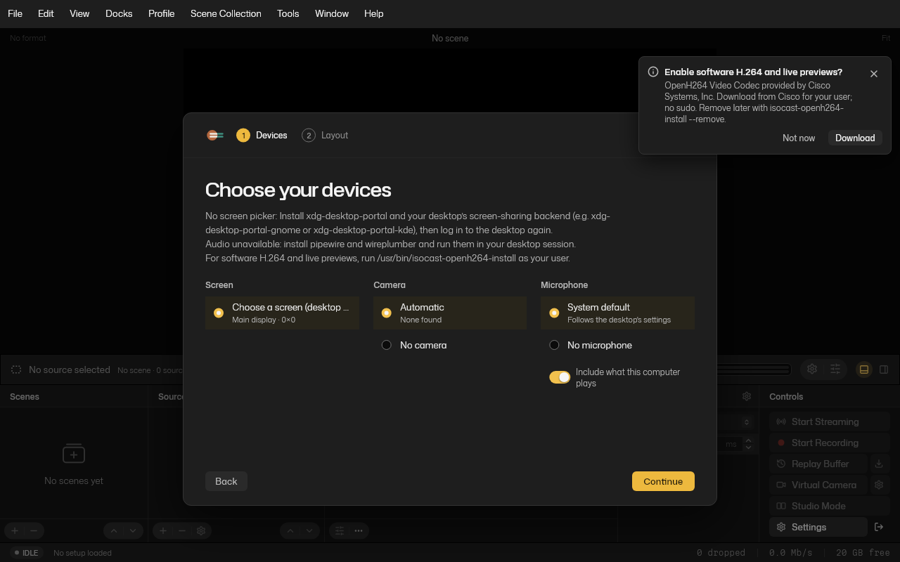

# Install Isocast on Linux

Draft for the first Linux release. The supported install and update route is the distro-specific `.deb`; no apt repository or in-app updater is required.

From [Isocast Releases](https://github.com/R44VC0RP/isocast/releases), download `SHA256SUMS` and **one** `.deb` into a new, empty folder. Match your distro and the architecture printed by `dpkg --print-architecture`: `amd64` for x86-64, `arm64` for AArch64. Run the following in that folder. A checksum verifies the download, not a package signature.

## Ubuntu 24.04

```sh
sha256sum --ignore-missing -c SHA256SUMS && sudo apt install ./isocast-*-ubuntu24.04-$(dpkg --print-architecture).deb
```

## Debian 12 (bookworm)

Screen and audio capture require PipeWire 1.0.5 or later. If bookworm-backports isn't already enabled, add it first:

```sh
echo 'deb https://deb.debian.org/debian bookworm-backports main' | sudo tee /etc/apt/sources.list.d/bookworm-backports.list
sudo apt update
sudo apt install -t bookworm-backports libpipewire-0.3-0 pipewire wireplumber
sha256sum --ignore-missing -c SHA256SUMS && sudo apt install ./isocast-*-debian12-$(dpkg --print-architecture).deb
```

The Debian 12 package does not include browser sources. Use Ubuntu 24.04 if you need them.

## First launch

Open **Isocast** from the app menu in your desktop session. Choose **Download** to get Cisco’s OpenH264 for software H.264 encoding and live previews. The app downloads and verifies the codec as your user; apt never installs it as root. You can skip it, or retry with `isocast-openh264-install` (no sudo). `isocast-openh264-install --remove` removes the codec. OpenH264 Video Codec provided by Cisco Systems, Inc.

Choose your devices in the wizard. When screen capture starts, your desktop asks which screen to share. If no picker opens, install `xdg-desktop-portal` and your desktop’s ScreenCast backend (GNOME: `xdg-desktop-portal-gnome`; KDE: `xdg-desktop-portal-kde`). For missing audio, check that `pipewire` and `wireplumber` are installed and running in your desktop session. `isocast doctor` reports capture and codec problems.



## Update

Finish any recording, stream or export, quit the app and stop the idle engine with `isocast engine shutdown`. Download the new `.deb` and its `SHA256SUMS` into an empty folder, then repeat the checksum and apt install command above. Settings and recordings stay in place. The tarballs are Ubuntu 24.04 builds with a per-user `install.sh`; don't layer a tar install over a `.deb`.
